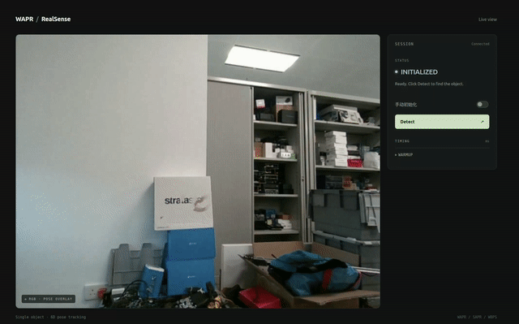

# WAPR-realsense

English | [中文](README.zh-CN.md)

RealSense RGB-D single-object 6D pose tracking based on [WAPR](https://github.com/WangYuLin-SEU/WAPR). This project uses YOLOE for automatic initialization and recovery after tracking failures, together with Kalman prediction to improve the initial pose supplied to each tracking step. It provides installation and usage instructions for deployment, including Jetson. Compared with supervised models that require object-specific data collection, annotation and training, this approach uses a 3D mesh and a few reference images of the target for fast, accurate 6D pose output.

<p align="center">
  
</p>

## Installation and startup

### 1. Prepare the environment and object model

| Platform | Python | Installation command |
| --- | --- | --- |
| Linux x86_64 | 3.10+ | `uv sync` / `uv sync --group common --python 3.10` |
| Orin NX / JetPack 5.1.1 | 3.8 | `uv sync --no-default-groups --group orin-nx-jetpack511 --python 3.8` |
| AGX Thor | 3.12 | `uv sync --no-default-groups --group thor --python 3.12` |

Run from the repository root:

```bash
uv sync
export WAPR_CACHE_DIR="$PWD/.wapr_runtime"
```

**For Jetson**:

```bash
# Orin NX / Python 3.8
ln -s /usr/lib/python3.8/dist-packages/tensorrt* .venv/lib/python3.8/site-packages/
# Thor / Python 3.12
ln -s /usr/lib/python3.12/dist-packages/tensorrt* .venv/lib/python3.12/site-packages/
```

```bash
source .venv/bin/activate
python -c 'import torch, tensorrt; print(torch.__version__, torch.cuda.is_available(), tensorrt.__version__)'
# Thor environment check:
python scripts/check_thor.py
```

Prepare runtime assets and export engines on first use:

```bash
python scripts/setup_runtime.py  # Check CUDA, install missing dependencies, prepare the rendering extension and download WAPR/SAPR/WBPS pose weights
python -m wapr.export_engines --object-mode single  # Export pose models from PyTorch to ONNX and build TensorRT engines
python -m wapr_realsense --check-camera  # Read one RealSense RGB-D frame, align depth, convert depth units, rectify if needed, print camera/depth information and exit
```

### 2. Prepare the required 3D mesh and reference views

Skip this step when using the bundled 3D mesh and reference data.

Use [camera_yoloe_fuse.py](examples/camera_yoloe_fuse.py) to create your own reference features:

```bash
python examples/camera_yoloe_fuse.py \
  --camera 8 --model yoloe-26s-seg.pt \
  --conf 0.05 --imgsz 640 --device 0 \
  --output outputs/yoloe_reference
```

`--camera` is the OpenCV camera index. The collection tool requires a local desktop window. Capture different views of the same target:

| Key | Action |
| --- | --- |
| `S` | Freeze the frame and select the target; Enter/Space confirms. Repeat to collect more views |
| `F` | Fuse all reference views, encode and export NPZ, then preview detection |
| `U` / `R` | Undo the last view / clear the collection; press `F` again after changes |
| `M` / `Q` | Toggle mask preview / quit |

Output files:

```text
outputs/yoloe_reference/
  prompt_embeddings.npz  # Reference features required by the tracking runtime
  reference_mosaic.png   # Reference-view mosaic
  boxes.xyxy.yaml        # Boxes in mosaic coordinates
  reference_boxes.jpg    # Box visualization
```

One NPZ represents one target class and can combine multiple views. The example combines three views: the front and two sides. The runtime loads the NPZ embeddings.

### 3. Start the interface

| Mode | Config | Input and purpose |
| --- | --- | --- |
| YOLOE | [box.example.yaml](configs/box.example.yaml) | Bundled box mesh and NPZ; automatic initialization and recovery localization |
| Manual ROI | Same config with `--init roi --no-yoloe` | User-supplied bbox; no detection model loaded |

```bash
python -m wapr_realsense --config configs/box.example.yaml --web --web-host 0.0.0.0
```

Open `http://127.0.0.1:8000` locally or `http://<device-ip>:8000` over the LAN. Change the port with `--web-port`.
After warmup, click **Detect**; draw a box first in manual mode. The web interface supports switching initialization modes. Switching modes or clicking Detect again resets the current track.

For an OpenCV window, omit `--web --web-host 0.0.0.0`. In manual mode, select a box on the frozen frame and confirm with Enter/Space.
Use `r` to reinitialize, `s` to save a snapshot and `q`/Esc to exit.

**Configuration and CLI overrides**

| Category | Override arguments |
| --- | --- |
| Pose inference | `--backend {trt,torch}` · `--object-mode {single,multi}` · `--min-score FLOAT` |
| Kalman switch | `--kalman` / `--no-kalman` |
| Prediction horizon | `--kalman-max-dt-s FLOAT` |
| Short-failure recovery | `--tracking-recovery` / `--no-tracking-recovery` · `--recovery-timeout-s FLOAT` · `--recovery-confirm-frames INT` |
| Initialization | `--init {roi,auto}` · `--bbox X Y W H` · `--detect-interval FLOAT` |
| YOLOE switch | `--yoloe` / `--no-yoloe` |
| Model and reference features | `--yoloe-model MODEL` · `--yoloe-prompt-embeddings PATH` · `--yoloe-device DEVICE` |
| YOLOE inference | `--yoloe-conf FLOAT` · `--yoloe-imgsz INT` · `--yoloe-max-candidates INT` |
| Interface | `--web` · `--web-host HOST` · `--web-port INT` · `--web-demo` · `--no-display` |
| Output and timing | `--output PATH` · `--print-every INT` · `--log-poses` · `--timing-interval FLOAT` · `--profile-tracking` · `--max-frames INT` |

## Orin NX, AGX Thor and laptop measurements

All three platforms use `configs/box.example.yaml` in Web mode, with TensorRT FP16 pose engines, `object_mode=single` and OpenGL rendering. YOLOE uses PyTorch.

| Metric | Orin NX 16G | Jetson AGX Thor | 4090 Laptop |
| --- | --- | --- | --- |
| Total startup preparation time (model loading, camera startup and warmup) | 40.52 s | 10.48 s | 7.60 s |
| Full automatic initialization time (one attempt) | 744.51 ms | 163.58 ms | 120.09 ms |
| Mean tracking time per frame | 234.5 ms | 57.00 ms | 26.38 ms |

**Use maximum performance mode for higher speed**

- List the available power modes: `sudo nvpmodel -q --verbose`
- Select the mode labeled MAXN / maximum performance in the output: `sudo nvpmodel -m <mode-id>`
- Lock CPU, GPU and memory clocks to the highest frequencies allowed by that mode: `sudo jetson_clocks`
- Inspect the settings: `sudo jetson_clocks --show`
- To also set the fan to maximum speed: `sudo jetson_clocks --fan`
- `jetson_clocks` fixes frequencies at the limits allowed by the current `nvpmodel` mode. Reboot before switching power modes after enabling it.

## Attribution, license and acknowledgements

This project adapts [WAPR](https://github.com/WangYuLin-SEU/WAPR) for RealSense and is not an official upstream release. The pose inference core derives from commit `f165cec8ebdd48ae6f46d06a46c40d796ab80b71`, with upstream backend modules retained.

Thanks to WAPR for the pose estimation foundation, [YOLOE / Ultralytics](https://github.com/ultralytics/ultralytics) for reference-image detection tools, and [FoundationPose++](https://github.com/teal024/FoundationPose-plus-plus) for the Kalman design reference.

Code retains [LGPL-2.1-only](LICENSE); model weights follow a separate [weights license](WEIGHTS_LICENSE.txt). Third-party components and models follow their respective licenses; see [authors](AUTHORS.md) and [third-party notices](THIRD_PARTY_NOTICES.txt). Preserve the relevant notices and license files when using and distributing the project.
