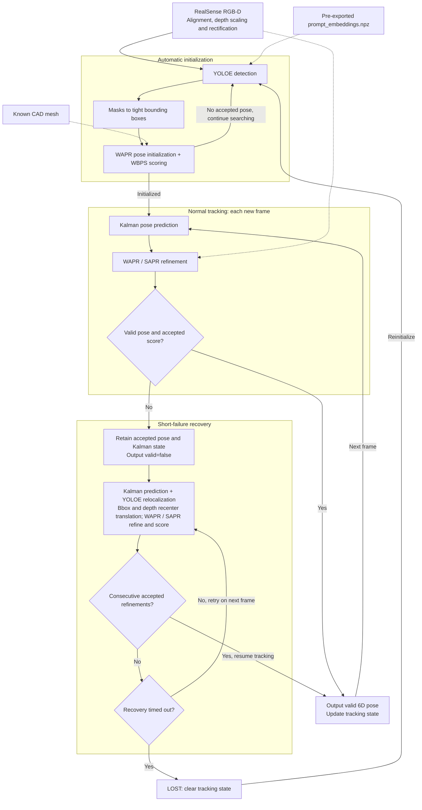

# WAPR-realsense

[中文](README.zh-CN.md)

RealSense RGB-D single-object 6D pose tracking based on [WAPR](https://github.com/WangYuLin-SEU/WAPR).
This project **replaces WAPR's original GroundingDINO + SAM2 + DINOv2 detector with YOLOE reference-image detection**
and adds Kalman prediction and bounded recovery for initialization, tracking and relocalization.
Local usage reports show substantially faster detection and initialization with YOLOE; the original pipeline is retained for comparison.
This guide focuses on the YOLOE workflow. The pose backend defaults to TensorRT and needs a matching, correctly scaled CAD mesh.



The diagram shows YOLOE automatic mode. Normal tracking does not run YOLOE. Recovery preserves predicted rotation
and uses a detection box and depth to recenter translation. Without a detection, it retains the Kalman seed;
valid pose output resumes only after consecutive accepted refinements confirm recovery.

[Setup](#setup) · [Initialization modes](#initialization-modes) · [Tracking and recovery](#tracking-and-recovery) · [Pose output](#pose-output) · [Useful commands](#useful-commands) · [TODO](#todo)

## Setup

### 1. Prepare the environment and object model

The desktop workflow has run on Linux, Python 3.10, an RTX 4090 Laptop GPU and a RealSense D455.
The system needs a CUDA toolkit, C++ compiler and EGL/GL development headers. From the repository root:

```bash
uv sync
source .venv/bin/activate
uv pip install -r requirements-yoloe.txt
export WAPR_CACHE_DIR="$PWD/.wapr_runtime"
```

For Jetson, select the matching platform dependency group in `pyproject.toml`.
The repository includes the [box example mesh](assets/meshes/box/) with its OBJ, MTL and texture in meters;
use [box.example.yaml](configs/box.example.yaml). For other targets, start from [target.example.yaml](configs/target.example.yaml)
and set `mesh`, `mesh_unit` and `mesh_scale`. Only `assets/meshes/box/` is allowed through `.gitignore`;
other local meshes, weights and engines remain ignored. YOLOE only loads pre-exported `prompt_embeddings.npz` at runtime;
see [YOLOE reference-image detection](#yoloe-reference-image-detection) to create it.
**Config paths resolve relative to the YAML file; explicit CLI arguments take precedence.**

### 2. Prepare runtime assets and TensorRT engines

Run on first use or when deploying to another machine. Skip asset preparation and export if the cache is ready:

```bash
python scripts/setup_runtime.py
python -m wapr.export_engines --object-mode single
python -m wapr_realsense --check-camera
```

Build engines on the target machine; build workspace defaults to **4 GiB**. `single` is the default capacity for this application.

### 3. Start the interface

Browser visualization with YOLOE automatic initialization:

```bash
python -m wapr_realsense --config configs/box.example.yaml --web --web-host 0.0.0.0
```

Open `http://127.0.0.1:8000` locally or `http://<device-ip>:8000` over the LAN. Change the port with `--web-port`.
After warmup, click **Detect**; draw a box first in manual mode. Switching initialization mode or clicking Detect again resets the track.

For an OpenCV window, omit `--web --web-host 0.0.0.0`. In manual mode, draw a box on the frozen image and confirm with Enter/Space.
Use `r` to reinitialize, `s` to save a snapshot and `q`/Esc to exit.

## Initialization modes

| Mode | Config | Input and purpose |
| --- | --- | --- |
| YOLOE | [box.example.yaml](configs/box.example.yaml) | Bundled box mesh and NPZ; localization during initialization and recovery |
| Manual ROI | [box.yaml](configs/box.yaml) | User-supplied bbox; no detector loaded |

### YOLOE reference-image detection

The public box example includes [reference images and an encoded NPZ](assets/references/box/), ready to load.
To create your own features, run the bundled [camera_yoloe_fuse.py](examples/camera_yoloe_fuse.py);
there is no need to switch to the Ultralytics repository:

```bash
python examples/camera_yoloe_fuse.py \
  --camera 8 --model yoloe-26s-seg.pt \
  --conf 0.05 --imgsz 640 --device 0 \
  --output outputs/yoloe_reference
```

`--camera` is the OpenCV camera index; collection needs a local desktop window. Capture different views of the same target:

| Key | Action |
| --- | --- |
| `S` | Freeze the frame and select the target; Enter/Space confirms. Repeat for more views |
| `F` | Fuse all views, encode and directly export NPZ, then preview detection |
| `U` / `R` | Undo the last view / clear collection; press `F` again after changes |
| `M` / `Q` | Toggle mask preview / quit |

Output files:

```text
outputs/yoloe_reference/
  prompt_embeddings.npz  # Reference features required by the tracking runtime
  reference_mosaic.png   # Collected views
  boxes.xyxy.yaml        # Boxes in mosaic coordinates
  reference_boxes.jpg    # Box visualization
```

One NPZ represents one target class with potentially multiple views. `F` completes reference encoding;
the runtime only loads NPZ. It accepts no image + bbox input and never repeats reference encoding,
reducing startup preparation. Detection inference on current frames still runs normally.
Re-export after changing references or weights, and use the same model for collection and tracking.

Use the exported NPZ for tracking:

```bash
python -m wapr_realsense --config configs/box.example.yaml \
  --yoloe-prompt-embeddings outputs/yoloe_reference/prompt_embeddings.npz \
  --web --web-host 0.0.0.0
```

For a different target, also update its CAD mesh and scale. Or set the NPZ path in YAML, relative to that YAML file:

```yaml
yoloe_detection:
  activate: true
  model: yoloe-26s-seg.pt
  prompt_embeddings: ../outputs/yoloe_reference/prompt_embeddings.npz
  conf: 0.05
  imgsz: 640
  device: "0"
  max_candidates: 3
```

If you already have a mosaic and xyxy box list, [prepare_yoloe_reference.py](scripts/prepare_yoloe_reference.py)
exports NPZ offline; see `--help` for arguments. `box.example.yaml` enables automatic mode.
For custom configs, select `--init auto` and `yoloe_detection.activate: true`.
`box.yoloe.yaml` retains the local target setup; use `box.example.yaml` for the public example.

YOLOE masks become tight boxes and WAPR uses its mask-free path. Initialization tries up to `max_candidates`
high-confidence boxes and selects the accepted pose with the highest 6D score. Normal tracking does not run YOLOE.
Recovery uses the highest-confidence depth-valid box without detection instance IDs.
Add `--init roi` for manual initialization with YOLOE-assisted recovery. YOLOE uses PyTorch even when WAPR uses TensorRT.

### Manual ROI initialization

```bash
python -m wapr_realsense --config configs/box.yaml --web --web-host 0.0.0.0
```

Draw a box on the frozen frame, then click Detect. Without YOLOE enabled, this route needs no detector or reference image.
Runs without a config also default to manual ROI.

The original WAPR three-model baseline is available for comparison: `python -m wapr_realsense --config configs/box.auto.yaml --web`.

## Tracking and recovery

Normal tracking follows **Kalman prediction → WAPR/SAPR refinement → WBPS scoring**.
Kalman supplies a search seed; output poses remain accepted WAPR estimates. It does not directly remove model error or TRT numerical drift.

```yaml
kalman_motion_prediction:
  activate: true
  max_dt_s: 0.5
tracking_recovery:
  activate: true
  timeout_s: 5.0
  confirm_frames: 2
```

A rejected tracking update enters `recovering`, retaining the last accepted pose and Kalman state for refinement on new frames.
With YOLOE enabled, a detection box and depth provide a new translation candidate while preserving predicted rotation.
Without a detection, the Kalman seed is retained. Recovery requires `confirm_frames` consecutive distinct capture frames
with accepted refinement; rejected results never update the filter. Prediction extrapolates for at most `max_dt_s`,
then holds that endpoint while retrying. Repeated failures do not extend the recovery window.

During recovery, output has `valid=false` and a null pose. Timeout clears state: automatic mode searches again;
manual mode waits for a new box. The example above uses 5 seconds; check each config for its actual value.
Without a config, Kalman and recovery default to disabled. Compare using `--no-kalman` or `--no-tracking-recovery`.

Bbox depth can include background. Large rotations, long occlusions and similar objects can still cause failure or target switching.
YOLOE reference loading and CPU detection have been exercised; live occlusion-recovery success rates and YOLOE performance on Jetson still need measurement.

## Pose output

The `output` directory contains:

| File | Content |
| --- | --- |
| `latest.json` | Atomically updated latest result for robot-side readers |
| `poses.jsonl` | Complete per-frame records |
| `camera.json` / `session.json` | Camera parameters and run configuration |

```bash
python examples/read_pose.py --input outputs/box_example/latest.json
```

The reader checks validity and freshness, rejecting results older than 500 ms by default.
Poses include a `4×4` transform, `R`, translation in meters and an `xyzw` quaternion:

```text
p_camera = R @ p_mesh + t_m
T_base_object = T_base_camera @ T_camera_object
```

The mesh frame is the original model frame after unit conversion and scaling. Camera axes: X right, Y down, Z forward.
Base-frame output requires measured calibration; see [camera_to_base.example.yaml](configs/camera_to_base.example.yaml)
and the reader's `--camera-to-base` option. WBPS scores rank candidates; they are not success probabilities.

## Useful commands

List CLI options with `python -m wapr_realsense --help`.
Run CPU regression tests with:

```bash
python -B -m unittest discover -s tests -v
```

Inspect the browser UI without a camera or CUDA using `python -m wapr_realsense --web-demo`; it displays simulated data.

## TODO

- [ ] **Evaluate YOLOE TensorRT acceleration**: determine whether export is worthwhile by comparing PyTorch / TensorRT latency, GPU memory and detection accuracy.
- [ ] **Benchmark Jetson FPS**: measure detection, initialization, tracking and end-to-end FPS / latency on Orin NX and AGX Thor, recording resolution, model and power mode.
- [ ] **Document a complete 3D mesh workflow**: cover multi-view capture, reconstruction, mesh cleanup, texturing, scale calibration, coordinate frames and export validation.
- [ ] **Run module ablations**: compare detection pipelines, Kalman prediction, bounded recovery, tracking presets and inference backends for speed, pose error, drift, loss rate and recovery success.
- [ ] **Compare with FoundationPose**: use identical hardware, RGB-D sequences, meshes and initialization conditions to evaluate pose accuracy, speed, resource usage and recovery after occlusion.

## Attribution and license

This is an application adaptation of WAPR, not an official upstream release. The inference core derives from commit
`f165cec8ebdd48ae6f46d06a46c40d796ab80b71`, with upstream backend modules retained.
Kalman design references [FoundationPose++](https://github.com/teal024/FoundationPose-plus-plus).
Code retains [LGPL-2.1-only](LICENSE); weights have a separate [license](WEIGHTS_LICENSE.txt).
Preserve [authors](AUTHORS.md), [third-party notices](THIRD_PARTY_NOTICES.txt) and bundled license files.
