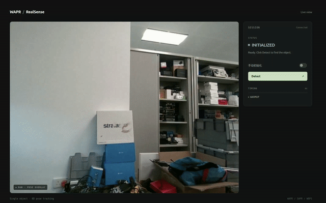

# WAPR-realsense

[English](README.md) | 中文

基于 [WAPR](https://github.com/WangYuLin-SEU/WAPR) 的 RealSense RGB-D 单目标 6D 位姿跟踪，本项目使用YOLOE来实现自动初始化和跟踪失败恢复，结合Kalman来改善每帧目标跟踪的搜索初值。提供详细方便的安装和使用教程，适用于在Jetson上部署，相比与传统监督模型需要针对特定物体进行数据采集标注和训练，本方法只需要目标物体的3D mesh和几张参考图片就可以完成快速准确的6D pose输出

<p align="center">
  
</p>

## 安装与启动

### 1. 准备环境和目标模型

| 平台 | Python | 安装命令 |
| --- | --- | --- |
| Linux x86_64 | 3.10+ | `uv sync` / `uv sync --group common --python 3.10` |
| Orin NX / JetPack 5.1.1 | 3.8 | `uv sync --no-default-groups --group orin-nx-jetpack511 --python 3.8` |
| AGX Thor | 3.12 | `uv sync --no-default-groups --group thor --python 3.12` |

在仓库根目录执行：

```bash
uv sync
export WAPR_CACHE_DIR="$PWD/.wapr_runtime"
```

**For Jetson**:


```bash
# Orin NX / Python 3.8
ln -s /usr/lib/python3.8/dist-packages/tensorrt* .venv/lib/python3.8/site-packages/
# Thor / Python 3.12
ln -s /usr/lib/python3.12/dist-packages/tensorrt* .venv/lib/python3.12/site-packages/
```

```bash
source .venv/bin/activate
python -c 'import torch, tensorrt; print(torch.__version__, torch.cuda.is_available(), tensorrt.__version__)'
# Thor 环境检查：
python scripts/check_thor.py
```

首次运行时,资源准备和导出：

```bash
python scripts/setup_runtime.py  # 检查 CUDA，补齐缺失依赖，准备渲染扩展，下载 WAPR/SAPR/WBPS 位姿模型权重
python -m wapr.export_engines --object-mode single  # 将位姿模型从 PyTorch 导出为 ONNX，再构建 TensorRT 引擎
python -m wapr_realsense --check-camera  # 读取一帧 RealSense RGB-D，完成深度对齐、深度单位转换和必要的去畸变，打印相机信息与有效深度比例，然后退出
```

### 2. 准备必须的3D mesh和参考视角图
(如果使用repo中自带的3D mesh和参考视角数据，这一步可以跳过)

创建自己的参考特征时，使用仓库内的 [camera_yoloe_fuse.py](examples/camera_yoloe_fuse.py)

```bash
python examples/camera_yoloe_fuse.py \
  --camera 8 --model yoloe-26s-seg.pt \
  --conf 0.05 --imgsz 640 --device 0 \
  --output outputs/yoloe_reference
```

`--camera` 是 OpenCV 相机编号；采集工具需要本地桌面窗口。采集同一目标的不同角度：

| 按键 | 操作 |
| --- | --- |
| `S` | 冻结当前帧并框选目标，Enter/空格确认；可重复采集多个视角 |
| `F` | 融合全部参考视角，编码并直接导出 NPZ，然后预览检测效果 |
| `U` / `R` | 撤销上一视角 / 清空采集；修改后重新按 `F` 导出 |
| `M` / `Q` | 切换 mask 预览 / 退出 |

输出包括：

```text
outputs/yoloe_reference/
  prompt_embeddings.npz  # 跟踪运行所需的参考特征
  reference_mosaic.png   # 参考视角拼图
  boxes.xyxy.yaml        # 拼图中的框坐标
  reference_boxes.jpg    # 框选可视化
```

一份 NPZ 对应一个目标类别，可融合多个视角，样例选择了物体的三个角度融合(正面和两个侧面)，运行时加载 NPZ Embedding

### 3. 启动界面

| 模式 | 配置 | 输入与用途 |
| --- | --- | --- |
| YOLOE | [box.example.yaml](configs/box.example.yaml) | 随仓库提供的 box mesh 和 NPZ；用于自动初始化和恢复定位 |
| 手动 ROI | 同一配置，加 `--init roi --no-yoloe` | 手动提供 bbox，不加载检测模型 |


```bash
python -m wapr_realsense --config configs/box.example.yaml --web --web-host 0.0.0.0
```

本机打开 `http://127.0.0.1:8000`，局域网打开 `http://<设备IP>:8000`，用 `--web-port` 修改端口。
预热结束后点击 **Detect**；手动模式需先拖框。网页支持切换初始化模式，切换或再次点击 Detect 会重置当前跟踪。

使用 OpenCV 窗口时去掉 `--web --web-host 0.0.0.0`；手动模式在冻结画面上框选后按 Enter/空格确认。
`r` 重新初始化、`s` 保存快照、`q`/Esc 退出。

**配置文件与命令行覆盖**

| 分类 | 可覆盖参数 |
| --- | --- |
| 位姿推理 | `--backend {trt,torch}` · `--object-mode {single,multi}` · `--min-score FLOAT` |
| Kalman 开关 | `--kalman` / `--no-kalman` |
| 预测时长上限 | `--kalman-max-dt-s FLOAT` |
| 短暂恢复 | `--tracking-recovery` / `--no-tracking-recovery` · `--recovery-timeout-s FLOAT` · `--recovery-confirm-frames INT` |
| 初始化 | `--init {roi,auto}` · `--bbox X Y W H` · `--detect-interval FLOAT` |
| YOLOE 开关 | `--yoloe` / `--no-yoloe` |
| 模型与参考特征 | `--yoloe-model MODEL` · `--yoloe-prompt-embeddings PATH` · `--yoloe-device DEVICE` |
| YOLOE 推理 | `--yoloe-conf FLOAT` · `--yoloe-imgsz INT` · `--yoloe-max-candidates INT` |
| 界面 | `--web` · `--web-host HOST` · `--web-port INT` · `--web-demo` · `--no-display` |
| 输出与计时 | `--output PATH` · `--print-every INT` · `--log-poses` · `--timing-interval FLOAT` · `--profile-tracking` · `--max-frames INT` |


## Orin NX、AGX Thor 与本机性能实测

均运行 `configs/box.example.yaml` 的 Web 模式，使用 TensorRT FP16 位姿引擎、`object_mode=single` 和 OpenGL 渲染；YOLOE 使用 PyTorch。

| 指标 | Orin NX 16G | Jetson AGX Thor | 4090 Laptop |
| --- | --- | --- | --- |
| 启动准备总耗时（模型加载、相机启动及预热） | 40.52 s | 10.48 s | 7.60 s |
| 完整自动初始化耗时（单次） | 744.51 ms | 163.58 ms | 120.09 ms |
| 跟踪每帧平均耗时 | 234.5 ms | 57.00 ms | 26.38 ms |

**使用最大性能模式来获取更快的速度**

- 查看本机支持的电源模式 `sudo nvpmodel -q --verbose`
- 选择输出中标为 MAXN / 最大性能的模式 `sudo nvpmodel -m <模式编号>`
- 锁定该模式允许的最高 CPU、GPU 和内存频率 `sudo jetson_clocks`
- 查看设置 `sudo jetson_clocks --show`
- 若要同时把风扇设为最高转速： `sudo jetson_clocks --fan`
- jetson_clocks 会将频率固定到当前 nvpmodel 模式允许的上限；运行后不能直接切换电源模式，若要切换需重启

## 来源、许可与致谢

本项目基于 [WAPR](https://github.com/WangYuLin-SEU/WAPR) 进行 RealSense 应用适配，非上游官方发布版本。位姿推理核心源自提交 `f165cec8ebdd48ae6f46d06a46c40d796ab80b71`，保留上游后端模块。

感谢 WAPR 提供位姿估计基础、[YOLOE / Ultralytics](https://github.com/ultralytics/ultralytics) 提供参考图检测工具，以及 [FoundationPose++](https://github.com/teal024/FoundationPose-plus-plus) 提供 Kalman 设计参考。

代码沿用 [LGPL-2.1-only](LICENSE)，模型权重遵循单独的[权重许可证](WEIGHTS_LICENSE.txt)。第三方组件与模型遵循各自许可证，详见[作者信息](AUTHORS.md)和[第三方声明](THIRD_PARTY_NOTICES.txt)；使用与分发时请保留相关声明和许可证文件。
