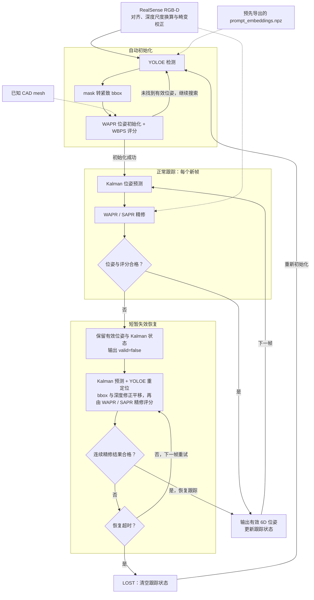

# WAPR-realsense

[English](README.md)

基于 [WAPR](https://github.com/WangYuLin-SEU/WAPR) 的 RealSense RGB-D 单目标 6D 位姿跟踪。
本项目使用 **YOLOE 参考图检测替代 WAPR 原有的 GroundingDINO + SAM2 + DINOv2 三模型路线**，
并加入 Kalman 预测和短暂失效恢复，用于自动初始化、跟踪和重新定位。
根据本地使用反馈，YOLOE 方案的检测初始化速度显著优于原三模型方案；原方案保留用于对照。
以下以 YOLOE 路线为主介绍。位姿后端默认 TensorRT，需要与实物对应、尺度正确的 CAD mesh。



图示为 YOLOE 自动模式：正常跟踪不运行 YOLOE；恢复时保留预测旋转，利用检测框和深度修正平移。
没有检测结果时继续使用 Kalman 初值，连续精修结果通过确认后才恢复有效位姿输出。

[安装与启动](#安装与启动) · [初始化模式](#初始化模式) · [跟踪与恢复](#跟踪与恢复) · [位姿输出](#位姿输出) · [常用命令](#常用命令) · [TODO](#todo)

## 安装与启动

### 1. 准备环境和目标模型

桌面环境已在 Linux、Python 3.10、RTX 4090 Laptop 和 RealSense D455 上运行。
系统需提供 CUDA toolkit、C++ 编译器及 EGL/GL 开发头文件。在仓库根目录执行：

```bash
uv sync
source .venv/bin/activate
uv pip install -r requirements-yoloe.txt
export WAPR_CACHE_DIR="$PWD/.wapr_runtime"
```

Jetson 请使用 `pyproject.toml` 中与平台匹配的依赖组。
仓库包含 [box 示例模型](assets/meshes/box/)的 OBJ、MTL 和纹理，单位为米，可使用 [box.example.yaml](configs/box.example.yaml)。
其他目标可从 [target.example.yaml](configs/target.example.yaml) 开始，设置 `mesh`、`mesh_unit` 和 `mesh_scale`。
`.gitignore` 仅开放 `assets/meshes/box/`，其他本地 mesh、权重和引擎继续忽略。
YOLOE 运行时只读取已导出的 `prompt_embeddings.npz`，创建方法见下文[YOLOE 参考图检测](#yoloe-参考图检测)。
**配置内路径相对 YAML 文件解析，命令行显式参数优先。**

### 2. 准备运行资源和 TensorRT 引擎

首次运行或更换部署机器时执行；已有可用缓存可跳过资源准备和导出：

```bash
python scripts/setup_runtime.py
python -m wapr.export_engines --object-mode single
python -m wapr_realsense --check-camera
```

引擎在目标机器上构建，构建 workspace 默认 **4 GiB**。`single` 是单目标应用的默认容量。

### 3. 启动界面

网页可视化，使用 YOLOE 自动初始化：

```bash
python -m wapr_realsense --config configs/box.example.yaml --web --web-host 0.0.0.0
```

本机打开 `http://127.0.0.1:8000`，局域网打开 `http://<设备IP>:8000`，用 `--web-port` 修改端口。
预热结束后点击 **Detect**；手动模式需先拖框。网页支持切换初始化模式，切换或再次点击 Detect 会重置当前跟踪。

使用 OpenCV 窗口时去掉 `--web --web-host 0.0.0.0`；手动模式在冻结画面上框选后按 Enter/空格确认。
`r` 重新初始化、`s` 保存快照、`q`/Esc 退出。
## 初始化模式

| 模式 | 配置 | 输入与用途 |
| --- | --- | --- |
| YOLOE | [box.example.yaml](configs/box.example.yaml) | 随仓库提供的 box mesh 和 NPZ；用于自动初始化和恢复定位 |
| 手动 ROI | [box.yaml](configs/box.yaml) | 手动提供 bbox，不加载检测模型 |

### YOLOE 参考图检测

公开 box 示例已包含 [参考拼图与 NPZ](assets/references/box/)，可直接使用。
创建自己的参考特征时，使用仓库内的 [camera_yoloe_fuse.py](examples/camera_yoloe_fuse.py)，无需切换到 Ultralytics 仓库：

```bash
python examples/camera_yoloe_fuse.py \
  --camera 8 --model yoloe-26s-seg.pt \
  --conf 0.05 --imgsz 640 --device 0 \
  --output outputs/yoloe_reference
```

`--camera` 是 OpenCV 相机编号；采集工具需要本地桌面窗口。采集同一目标的不同角度：

| 按键 | 操作 |
| --- | --- |
| `S` | 冻结当前帧并框选目标，Enter/空格确认；可重复采集多个视角 |
| `F` | 融合全部参考视角，编码并直接导出 NPZ，然后预览检测效果 |
| `U` / `R` | 撤销上一视角 / 清空采集；修改后重新按 `F` 导出 |
| `M` / `Q` | 切换 mask 预览 / 退出 |

输出包括：

```text
outputs/yoloe_reference/
  prompt_embeddings.npz  # 跟踪运行所需的参考特征
  reference_mosaic.png   # 参考视角拼图
  boxes.xyxy.yaml        # 拼图中的框坐标
  reference_boxes.jpg    # 框选可视化
```

一份 NPZ 对应一个目标类别，可融合多个视角。`F` 已完成参考图编码，运行时只加载 NPZ，
不接受 image + bbox，也不重复编码参考图，从而减少启动准备工作；当前帧的检测推理仍正常执行。
修改参考图或模型权重后重新导出，并在采集和运行时使用同一模型。

将生成的 NPZ 用于跟踪：

```bash
python -m wapr_realsense --config configs/box.example.yaml \
  --yoloe-prompt-embeddings outputs/yoloe_reference/prompt_embeddings.npz \
  --web --web-host 0.0.0.0
```

更换目标还需修改配置中的 CAD mesh 和尺度。也可在 YAML 中设置路径（相对该 YAML 文件）：

```yaml
yoloe_detection:
  activate: true
  model: yoloe-26s-seg.pt
  prompt_embeddings: ../outputs/yoloe_reference/prompt_embeddings.npz
  conf: 0.05
  imgsz: 640
  device: "0"
  max_candidates: 3
```

已有参考拼图和 xyxy 框列表时，可用 [prepare_yoloe_reference.py](scripts/prepare_yoloe_reference.py) 离线导出 NPZ，参数见 `--help`。
`box.example.yaml` 已开启自动模式；自定义配置可用 `--init auto` 开启，再由 `yoloe_detection.activate: true` 选择 YOLOE。
`box.yoloe.yaml` 保留本地目标配置；公开示例使用 `box.example.yaml`。

YOLOE 将 mask 转为紧致 bbox，WAPR 走无 mask 路线。初始化最多尝试 `max_candidates` 个高置信度框，
选择评分合格且 6D 评分最高的位姿；正常 tracking 不运行 YOLOE。恢复使用最高置信度且有有效深度的框，不维护检测实例 ID。
加 `--init roi` 可手动初始化、仅在恢复时使用 YOLOE。WAPR 使用 TensorRT 时，YOLOE 仍使用 PyTorch。

### 手动 ROI 初始化

```bash
python -m wapr_realsense --config configs/box.yaml --web --web-host 0.0.0.0
```

在冻结画面上拖框，再点击 Detect。不启用 YOLOE 时，这条路线无需检测模型和参考图；
不带配置启动也默认采用手动 ROI。

原 WAPR 的三模型检测仅作对照：`python -m wapr_realsense --config configs/box.auto.yaml --web`。

## 跟踪与恢复

正常跟踪由 **Kalman 预测 → WAPR/SAPR 精修 → WBPS 评分**组成。
Kalman 为搜索提供初值，对外仍输出通过检查的 WAPR 位姿；它不直接消除模型误差或 TRT 数值漂移。

```yaml
kalman_motion_prediction:
  activate: true
  max_dt_s: 0.5
tracking_recovery:
  activate: true
  timeout_s: 5.0
  confirm_frames: 2
```

跟踪评分不合格后进入 `recovering`，保留最近有效位姿和 Kalman 状态，在新帧上继续精修。
启用 YOLOE 时，检测框与深度提供新的平移候选，保留预测旋转；检测失败时继续用 Kalman 初值。
连续 `confirm_frames` 个不同采集帧的精修结果通过检查才恢复跟踪，拒绝结果不更新滤波器。
累计预测最多外推 `max_dt_s`，随后保持预测终点继续尝试；恢复窗口不会因失败而延长。

恢复期间输出 `valid=false` 和空位姿。超时后清空状态：自动模式重新搜索，手动模式等待新框选。
上例为 5 秒窗口；各配置的实际值以 YAML 为准。无配置运行时，Kalman 和恢复默认关闭。
可用 `--no-kalman`、`--no-tracking-recovery` 做对比。

目前 bbox 深度可能混入背景，大幅旋转、长期遮挡和多个相似物体仍可能导致失败或目标切换。
YOLOE 已验证参考特征加载与 CPU 检测，实时遮挡恢复成功率和 Jetson 上的 YOLOE 性能仍需实测。

## 位姿输出

输出目录由 `output` 指定，包含：

| 文件 | 内容 |
| --- | --- |
| `latest.json` | 原子更新的最新结果，供机器人端读取 |
| `poses.jsonl` | 每帧完整结果 |
| `camera.json` / `session.json` | 相机参数和本次运行配置 |

```bash
python examples/read_pose.py --input outputs/box_example/latest.json
```

读取示例检查 `valid` 和时效性，默认拒绝超过 500 ms 的结果。位姿包含 `4×4` 变换、`R`、米制平移和 `xyzw` 四元数：

```text
p_camera = R @ p_mesh + t_m
T_base_object = T_base_camera @ T_camera_object
```

mesh 坐标系为原始模型经单位换算和缩放后的坐标系；相机 X 向右、Y 向下、Z 向前。
基座转换需提供实测标定，参考 [camera_to_base.example.yaml](configs/camera_to_base.example.yaml) 和读取脚本的 `--camera-to-base` 参数。
WBPS 分数用于候选排序，不是成功概率。

## 常用命令

查看全部命令行选项：`python -m wapr_realsense --help`。运行 CPU 回归测试：

```bash
python -B -m unittest discover -s tests -v
```

无需相机或 CUDA 检查网页交互：`python -m wapr_realsense --web-demo`，页面使用模拟数据。

## TODO

- [ ] **YOLOE TensorRT 加速评估**：判断是否需要导出 TensorRT，对比 PyTorch / TensorRT 的延迟、显存和检测精度。
- [ ] **Jetson 实机 FPS 测试**：在 Orin NX 和 AGX Thor 上测量检测、初始化、跟踪及端到端 FPS / 延迟，记录分辨率、模型和功耗模式。
- [ ] **3D mesh 建模流程**：整理从多视角采集、重建、网格清理、纹理生成到尺度校准、坐标系设置和导出验证的完整方法。
- [ ] **模块消融实验**：对比检测路线、Kalman、短暂恢复、跟踪预设和推理后端，评估速度、位姿误差、漂移、丢失率及恢复成功率。
- [ ] **FoundationPose 对比**：使用相同硬件、RGB-D 序列、mesh 和初始化条件，对比位姿精度、运行速度、资源占用及遮挡后的恢复能力。

## 来源与许可

本项目是 WAPR 的应用改编，并非上游官方发行版。推理核心源自 commit
`f165cec8ebdd48ae6f46d06a46c40d796ab80b71`，保留上游后端模块。
Kalman 设计参考 [FoundationPose++](https://github.com/teal024/FoundationPose-plus-plus)。
代码保留 [LGPL-2.1-only](LICENSE)，模型权重适用独立[许可](WEIGHTS_LICENSE.txt)。
保留[作者声明](AUTHORS.md)、[第三方声明](THIRD_PARTY_NOTICES.txt)和随附许可文件。
